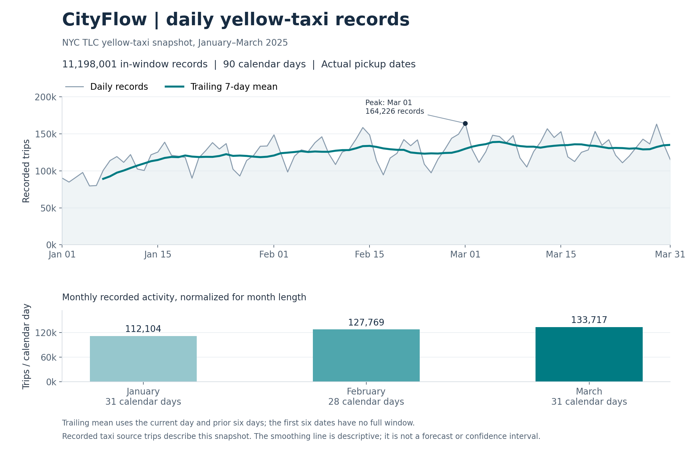

# CityFlow — Urban Mobility Analytics

A reproducible SQL analytics pipeline for NYC yellow-taxi records: Python ingestion
with source version tracking, a DuckDB/dbt warehouse, tested analytical marts and
inspectable results. The project asks how recorded activity and directed route metrics vary
across the first quarter of 2025.

**January–March 2025 · 11,198,001 in-window records · 90 calendar days**



The smoothing line is a full trailing seven-day mean. Monthly rates use every
calendar day. See [figure definitions and provenance](docs/figure_design.md) and
[the full results report](docs/results/overview.md).

## Questions and findings

- How did recorded trips per calendar day change across pickup months?
- Which directed NYC zone pairs had the most recorded trips?
- How did eligible route duration/fare distributions differ between adjacent months?

| Pickup month | Recorded trips | Trips/calendar day | Eligible duration median | Eligible fare median |
| --- | ---: | ---: | ---: | ---: |
| January | 3,475,234 | 112,104 | 11.70 min | $12.80 |
| February | 3,577,542 | 127,769 | 12.22 min | $13.50 |
| March | 4,145,225 | 133,717 | 12.52 min | $14.10 |

These are descriptive source-record patterns. Changes can reflect trip mix,
payment/rate categories and time of day; they do not establish causal congestion
effects, fare inflation or changes in all urban travel. Duration and fare metrics
use independent eligible cohorts. See [analytical definitions](docs/analytics_design.md)
for thresholds, grains and interpretation limits.

## Engineering demonstrated

| Capability | Implementation and evidence |
| --- | --- |
| Versioned ingestion | SHA-256 source tracking, unchanged-file skips, explicit partition replacement and transactional reconciliation |
| Dimensional modeling | Source-preserving fact records, two directed zone joins, unique zone IDs and a complete date dimension |
| Analytical SQL | Conditional cohorts, medians/p90, route/month grids, dense ranks, LAG and guarded percentage changes |
| Validation | 15 pytest cases; 33 dbt data tests; synthetic boundary/zero/rank/coverage checks; real snapshot reconciliation |
| Performance reasoning | Equivalent fact/mart count results, repeated warm reads, captured plans and separate build-cost evidence |
| Continuous integration | GitHub Actions runs the fixture pipeline and retains logs, dbt artifacts and a labeled results report |

The selected real analytics build (three models and 17 tests) took **6.859 seconds**
on the development Mac. A warm benchmark returned the same **103,709 geographic
route-month count rows** in median **0.823 s from facts** versus **0.077 s from the
saved mart**, a **10.7× elapsed ratio for that read**. This measures reuse of stored
aggregation and excludes its refresh cost. It is not an end-to-end speedup or a
cross-machine performance claim. See [benchmark evidence](docs/performance/baseline/summary.md)
and [the materialization decision](docs/performance/decision.md).

## Architecture

Python activates versioned raw source partitions. dbt standardizes fields, preserves
records with explicit eligibility flags, adds zone details and builds daily and
route-month marts. A complete calendar and route-month grid keep zero months
visible. Exported small reports and the figure provide reproducible evidence.

See [the model-flow schematic](docs/architecture.md), [warehouse design](docs/warehouse_design.md),
and [performance/CI contract](docs/performance_and_ci.md).

## Snowflake validation

The full January–March 2025 snapshot was rebuilt in Snowflake, 
and all three analytical marts (`mart_daily_activity`, `mart_route_monthly`, and `mart_route_month_comparison`) 
reconciled with DuckDB under the documented tolerances (`all_equal: true`).
See the [Snowflake design](docs/snowflake_design.md) and [Snowflake validation results](docs/snowflake_results/summary.md). 
After evidence was saved, the dedicated Snowflake databases, role, warehouse, and resource monitor were removed. 
The local DuckDB project and source data were retained.

## Reproduce the synthetic pipeline

Requires Python 3.11 and Git. Run from the repository root on macOS/Linux:

```bash
python3.11 -m venv .venv
source .venv/bin/activate
python -m pip install -r requirements.txt
python -m pip check
python scripts/run_ci_checks.py
```

This uses generated fixture inputs and an isolated local database. Expected: 15
pytest cases, eight models/33 dbt tests, and synthetic pickup-month counts **5/3/4**.
The labeled fixture report is under `reports/ci/exports/overview.md`.
For a repeat, use `--output-dir reports/ci-repeat` to preserve prior evidence.
No real TLC downloads or cloud credentials are needed for this smoke path.

The [CI workflow](.github/workflows/ci.yml) runs those same checks on PRs and main
with Python 3.11. Real-data validation remains a separate local checkpoint.

## Real snapshot and analytical outputs

The frozen inputs are the January–March 2025 yellow-taxi Parquet files and 265-row
taxi-zone lookup from [NYC TLC](https://www.nyc.gov/site/tlc/about/tlc-trip-record-data.page).
Source URLs, full active hashes and row counts are recorded in
[export metadata](docs/results/run_metadata_2025q1.json). Large files/databases are
ignored; small synthetic fixtures, code and selected evidence are committed.

The raw input has 11,198,026 records. All raw records remain represented in the
fact table; the 25 pickups outside the quarter are excluded from observed-activity
summaries. Other anomalies use metric-specific flags rather than globally deleting
records. Filenames identify source partitions; analytical months use actual pickup
dates. Identical-looking source records are retained and given provenance-based IDs.

Once local inputs are available under `data/raw/`, run:

```bash
python scripts/ingest_sources.py
dbt build --project-dir dbt --profiles-dir dbt
python scripts/export_analytics.py
```

When upstream models are already current, select only the analytical nodes:

```bash
dbt build --project-dir dbt --profiles-dir dbt --select tag:analytics
python scripts/export_analytics.py
python scripts/benchmark_queries.py --output-dir reports/performance/new_run
```

See the source configuration and [data contract](docs/data_contract.md) for the
snapshot specification. Source hashes identify inputs; coverage checks do not
prove that the upstream vendor submissions capture every real-world taxi trip.
Source-local wall-clock duration calculations retain daylight-saving ambiguity.

## Regenerate the figure

```bash
python -m pip install -r requirements-viz.txt
python scripts/plot_portfolio.py --output-dir reports/portfolio/new_render
```

The plot uses committed daily/monthly exports, validates their counts/calendar
and writes PNG, SVG and figure metadata. See [figure definitions](docs/figure_design.md)
for the rolling-window rule, input hashes and recorded plotting environment.

## Local dashboard

The local Streamlit dashboard supports pickup-date activity exploration and directed-route
month comparisons using the validated DuckDB snapshot. It preserves eligible cohorts,
zero-trip months, sample thresholds and undefined growth from zero. See the
[dashboard guide](docs/dashboard_guide.md), [design](docs/dashboard_design.md), and
[validation results](docs/dashboard_results/summary.md).

Run from the repository root after installing the dashboard environment:

```bash
.venv-dashboard/bin/python -m streamlit run dashboard/app.py
```

Open http://127.0.0.1:8501. Stop the server with Ctrl+C in its terminal.

## Public dashboard

[Open CityFlow](https://cityflow-mark.streamlit.app)

The public app serves a validated Snowflake aggregate snapshot for January–March
2025, with whole-month activity and selected directed routes. A dedicated key-pair
service identity was tested from the hosted app before switching to credential-free
snapshot mode and removing the dedicated Snowflake resources. The full local
dashboard retains arbitrary date filters and the complete route catalog.

See [deployment design](docs/hosting_design.md),
[deployment results](docs/hosting_results/summary.md), and
[deployment guide](docs/hosting_guide.md).

## Next milestones

See [the remaining roadmap](docs/remaining_roadmap.md). Local dashboard validation
and Snowflake parity are complete. Cloud hosting of the dashboard is complete.
