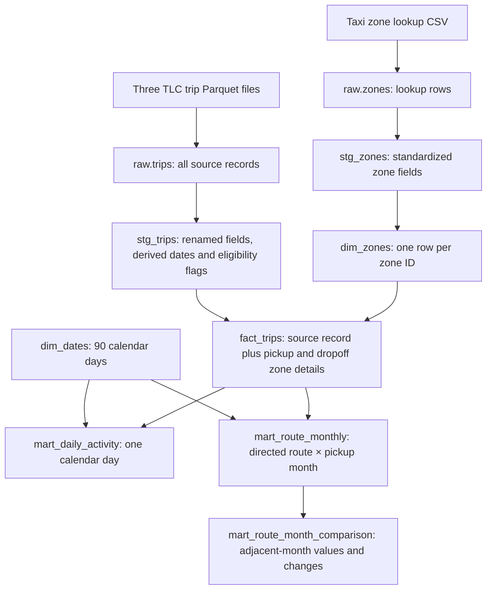

# Cityflow architecture and model flow

The local pipeline transforms a frozen January–March 2025 NYC yellow-taxi
snapshot into tested analytical tables. Every layer has an explicit row grain.

Python ingestion records SHA-256 versions and row counts in `meta.loaded_sources`
and successful activations in `meta.load_history`. It skips unchanged sources;
changed bytes require an explicit replacement choice, with per-partition
transactional reconciliation. Provenance remains attached to fact rows. The
registry records active versions; it is not a backup of replaced source data.

`fact_trips` keeps source records and joins `dim_zones` twice: once for pickup and
once for dropoff. A dimension row has a unique ID, so those joins must not multiply
trip rows. Missing lookup matches remain visible as unmapped fields. Independent
flags govern observed activity, duration, fare, total-charge and distance cohorts.

dbt's `source()` points at existing raw relations. `ref()` names another model and
adds a dependency to dbt's build graph. CTEs inside a SQL file are query-scoped
named relations; aliases introduced by FROM/JOIN are query-scoped nicknames.
SQL's textual SELECT-first order differs from the logical dependency order.

## Route-month model internals

| CTE | Inputs | Row grain and job |
| --- | --- | --- |
| observed | fact_trips | One in-window source record; derive route key, actual pickup month and geographic flag |
| routes | observed | One directed route found anywhere in the quarter |
| months | dim_dates | One month and its calendar-day count |
| monthly | observed | One active route-month; compute counts and eligible duration/fare distributions |
| coverage | Source registry macro | One row saying whether the expected snapshot is loaded |
| complete_grid | routes × months × coverage, LEFT JOIN monthly | One route-month, including zero months when coverage is complete |
| geographic_ranks | complete_grid | Rank positive-volume geographic routes within each month |
| Final SELECT | complete_grid, LEFT JOIN geographic_ranks | Add normalized activity, sample flags and applicable ranks |

A CROSS JOIN forms every route-month pair. A LEFT JOIN adds existing activity
while retaining pairs that have no matching aggregate. Complete coverage permits
absent counts to become zero; incomplete coverage makes numeric summaries null.
This distinction prevents a missing source file from becoming apparent inactivity.

The complete month grid makes the comparison model's LAG mean the previous
calendar month. January has no predecessor. A February zero month remains the
predecessor of March, and percentage change from zero is undefined.

## Engineering evidence

| Mechanism | What it verifies |
| --- | --- |
| Ingestion unit tests | Version skips, partition replacement, row preservation and failure behavior |
| Fixture pipeline tests | Known cohort counts, joins, boundary dates, grids, ranks and guarded comparisons |
| dbt data tests | Keys, nullability, calendar coverage, source versions, count reconciliation and metric invariants |
| Plot validation tests | Complete calendar, daily/monthly denominators, full trailing windows and export total |
| Benchmark equivalence | Every returned geographic route-month count agrees between fact and mart queries |
| GitHub CI | The same reproducible synthetic checks on proposed changes and main |

The exporter writes local full aggregates and small committed evidence. The plot
reads those committed aggregates, validates them and records input/source hashes.
Real-data checks remain separate from CI's generated fixtures. See
[warehouse design](warehouse_design.md), [analytical definitions](analytics_design.md),
[performance and CI](performance_and_ci.md) and [plot definitions](figure_design.md).
